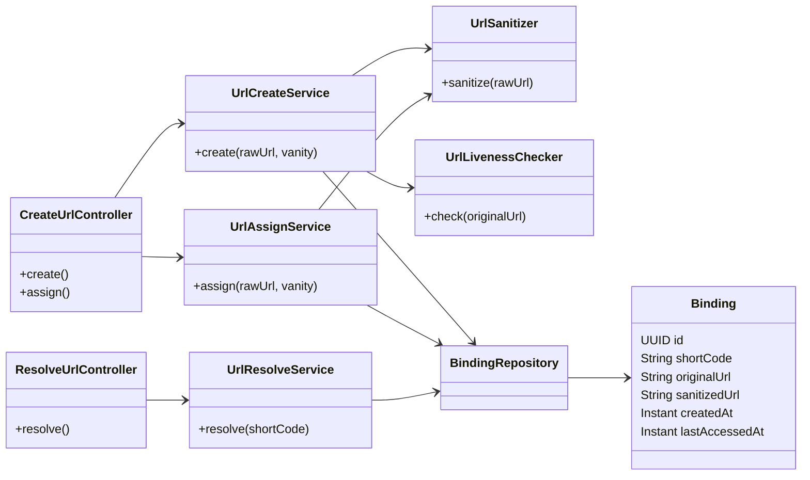
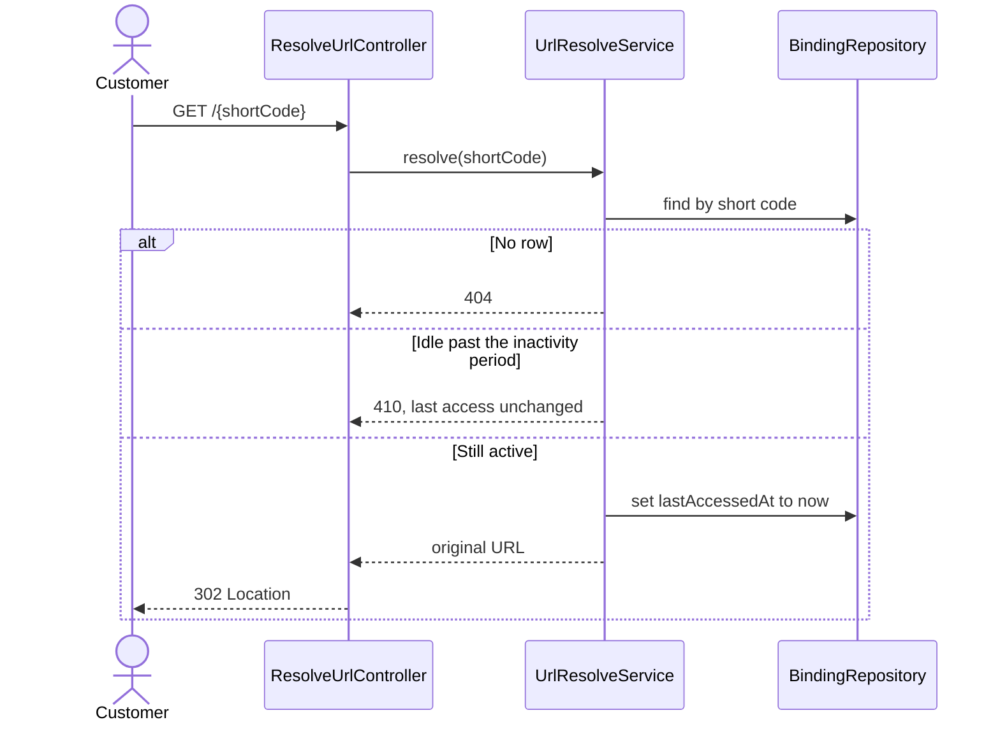

# Shorty

Shorty is a small URL shortener for merchants. A merchant pastes a long destination, such as an order page, and receives a short URL. A customer who opens that short URL is redirected to the original address. The short code does not contain the destination.

The running service also serves a one-page merchant form at the site root.

## Features

- Authenticated create of a short URL, with an optional vanity code.
- The same destination returns the existing short URL instead of a second binding.
- Public resolve with an HTTP 302 redirect. Resolve does not require a login.
- The pasted URL is checked for liveness before it is stored. Redirects are not followed.
- Idle short URLs expire after a configurable period. A successful open resets the window.
- An existing short URL can later be renamed to a free vanity. The destination stays the same.

## Technologies

| Piece | Choice |
| --- | --- |
| Language | Java 21 |
| Application | Spring Boot 4.1.1 |
| HTTP API | Spring Web MVC |
| Auth | Spring Security, HTTP Basic, stateless |
| Persistence | Spring Data JPA and H2 (in-memory) |
| Outbound probe | Spring RestClient on the JDK HTTP client |
| Build | Gradle 9.7.1, via the wrapper in `shorty-url` |
| Tests | JUnit 5, Spring MockMvc, OkHttp MockWebServer |

Bindings live in an in-memory H2 database. Restarting the process drops them.

## Requirements

- JDK 21
- No separate database install

## Run

From `shorty-url`:

```bat
gradlew.bat bootRun
```

On macOS or Linux, use `./gradlew bootRun`.

Then open [http://localhost:8080/](http://localhost:8080/). The form is filled with the default merchant account, `merchant` / `merchant`.

## How to use it

### In the browser

1. Leave the username and password as `merchant` / `merchant`, or replace them if you changed the account.
2. Paste an `http` or `https` destination into **Long URL**.
3. Choose **Create tiny URL**. Leave vanity blank to get a generated code, or type a free vanity such as `spring-sale`.
4. Open the tiny URL that comes back. The browser should land on the destination you pasted.
5. To rename a destination that already has a short URL, paste that long URL (or the current tiny URL) into **Long URL**, type a free vanity, and choose **Assign vanity**. The old code stops working. The new one redirects to the same destination.

Create and assign send the username and password as HTTP Basic credentials. Opening a tiny URL does not.

### With HTTP

Create, or return the existing short URL for the same destination. A new binding is **201**. A repeat of the same sanitized URL is **200** and keeps the current code, even if the body also asks for a vanity.

```bat
curl -u merchant:merchant -H "Content-Type: application/json" -d "{\"url\":\"https://example.com/orders/42\"}" http://localhost:8080/api/v1/urls
```

```json
{
  "tinyUrl": "http://localhost:8080/k7Hx0aB9cQ",
  "originalUrl": "https://example.com/orders/42"
}
```

Create with a vanity:

```bat
curl -u merchant:merchant -H "Content-Type: application/json" -d "{\"url\":\"https://example.com/orders/42\",\"vanity\":\"spring-sale\"}" http://localhost:8080/api/v1/urls
```

Assign a free vanity to a destination that already exists. You can pass the original long URL or the current tiny URL. The response is **200**.

```bat
curl -u merchant:merchant -H "Content-Type: application/json" -d "{\"url\":\"https://example.com/orders/42\",\"vanity\":\"fall-sale\"}" http://localhost:8080/api/v1/urls/vanity
```

Open a short URL. An active code responds with **302** and a `Location` header set to the original paste. No credentials.

```bat
curl -I http://localhost:8080/spring-sale
```

### Rules that affect the result

- Only `http` and `https` URLs are accepted. The host is lowercased and a fragment (`#...`) is dropped before the duplicate check. The response still shows the URL you pasted.
- A vanity is 1–64 characters: letters, digits, `_`, and `-`. The exact names `api` and `error` are reserved. `API` is allowed.
- A vanity already bound to a different destination is **409**.
- Create probes the pasted URL with HTTP GET and does not follow redirects. A 2xx or 3xx response may be stored. A 4xx fails once. A timeout or 5xx is tried up to 3 times, 30 seconds each. Failure is **502** and nothing new is stored. If that destination already expired, the old row is not refreshed.
- With no successful open for 5 minutes, resolve returns **410** and does not redirect. A later successful create of the same destination reuses the row and starts the window again.
- Unknown codes are **404**. Missing credentials on create or assign are **401**. A blank or invalid URL or vanity is **400**. Errors use [RFC 9457](https://www.rfc-editor.org/rfc/rfc9457) problem details.

## Configuration

Defaults are in `shorty-url/src/main/resources/application.properties`.

| Property | Default | Meaning |
| --- | --- | --- |
| `server.port` | `8080` | HTTP port |
| `spring.security.user.name` | `merchant` | Basic Auth user for create and assign |
| `spring.security.user.password` | `merchant` | Basic Auth password |
| `shortyurl.public-base-url` | `http://localhost:8080/` | Prefix used to build tiny URLs |
| `shortyurl.inactivity` | `5m` | Idle time before a short URL expires |
| `shortyurl.liveness.max-attempts` | `3` | Probe attempts for timeout and 5xx |
| `shortyurl.liveness.timeout` | `30s` | Per-attempt probe budget |
| `shortyurl.liveness.max-body-bytes` | `65536` | Body bytes read during a probe; hitting the cap does not fail a 2xx or 3xx |

## Diagrams

The classes below are the path from HTTP to the stored binding. Controllers stay thin. Create, assign, and resolve each have a service. `Binding` is the only persisted row: one short code, the original paste, and a sanitized key used for duplicates.



Create either inserts a new binding or returns the one already stored for that sanitized URL. The liveness probe runs on the pasted string, not on the sanitized key. A requested vanity is stored only when the destination is new and the code is free.

```mermaid
sequenceDiagram
    actor Merchant
    participant API as CreateUrlController
    participant Create as UrlCreateService
    participant Sanitize as UrlSanitizer
    participant Live as UrlLivenessChecker
    participant DB as BindingRepository

    Merchant->>API: POST /api/v1/urls
    API->>Create: create(url, vanity)
    Create->>Sanitize: sanitize
    Sanitize-->>Create: sanitized URL
    Create->>DB: find by sanitized URL
    alt New URL and vanity already taken
        Create-->>API: 409
    else Destination can be considered
        Create->>Live: GET pasted URL
        alt Probe fails
            Live-->>Create: failure
            Create-->>API: 502, no new row
        else Probe succeeds and a row exists
            Create->>DB: reload row
            Create-->>API: 200 current tiny URL
        else Probe succeeds and no row exists
            Create->>DB: insert short code and original URL
            Create-->>API: 201 new tiny URL
        end
    end
```

Resolve is public. It refuses an expired code before it updates the last-access time, so a 410 does not extend the window.



## Tests

From `shorty-url`:

```bat
gradlew.bat test
```

The test profile shortens inactivity to 5 seconds and the liveness timeout to 500 milliseconds so the suite does not wait out the production settings.

## Project layout

```
shorty-url/          Spring Boot service
  src/main/java/     controllers, services, and the Binding entity
  src/main/resources/static/index.html
  src/test/java/     unit and MockMvc tests
_bmad-output/specs/  product contract and story files
```

The contract for what the service must do is `_bmad-output/specs/spec-tiny-url-service/SPEC.md`.
