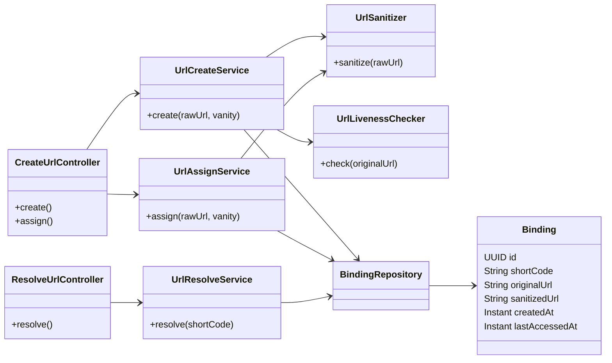
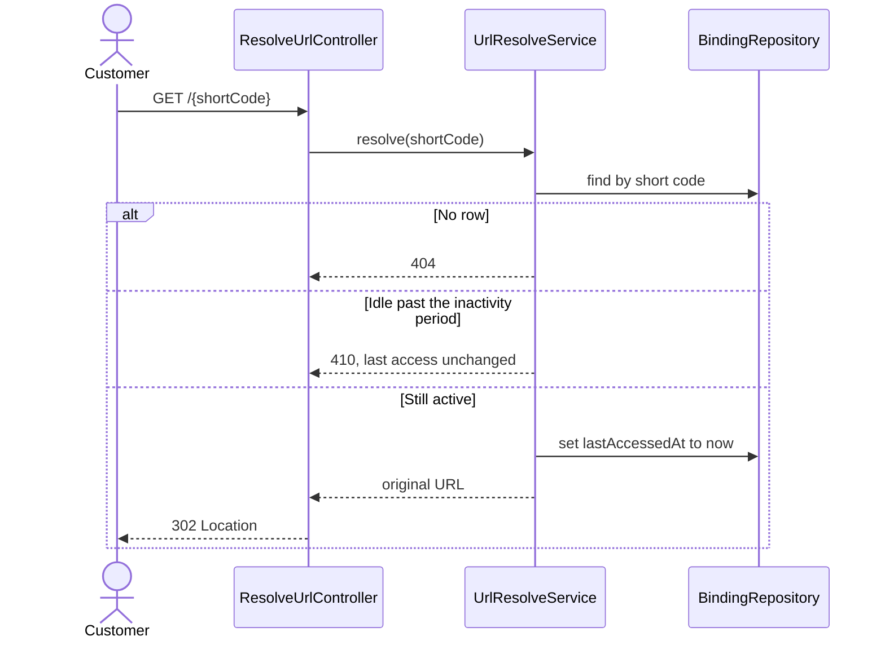

# Shorty

Shorty is a small URL shortener for merchants. A merchant pastes a long destination, such as an order page, and receives a short URL. A customer who opens that short URL is redirected to the original address. The short code does not contain the destination.

The running service also serves a one-page merchant form at the site root.

## Features

- Authenticated create of a short URL, with an optional vanity code.
- The same destination returns the existing short URL instead of a second binding.
- Public resolve with an HTTP 302 redirect. Resolve does not require a login.
- The pasted URL is checked for liveness before it is stored. Redirects are not followed.
- Idle short URLs expire after a configurable period. A successful open resets the window.
- An existing short URL can later be renamed to a free vanity. The destination stays the same.

## Technologies

| Piece | Choice |
| --- | --- |
| Language | Java 21 |
| Application | Spring Boot 4.1.1 |
| HTTP API | Spring Web MVC |
| Auth | Spring Security, HTTP Basic, stateless |
| Persistence | Spring Data JPA and H2 (in-memory) |
| Outbound probe | Spring RestClient on the JDK HTTP client |
| Build | Gradle 9.7.1, via the wrapper in `shorty-url` |
| Tests | JUnit 5, Spring MockMvc, OkHttp MockWebServer |

Bindings live in an in-memory H2 database. Restarting the process drops them.

## Requirements

- JDK 21
- No separate database install

## Run

From `shorty-url`:

```bat
gradlew.bat bootRun
```

On macOS or Linux, use `./gradlew bootRun`.

Then open [http://localhost:8080/](http://localhost:8080/). The form is filled with the default merchant account, `merchant` / `merchant`.

## How to use it

### In the browser

1. Leave the username and password as `merchant` / `merchant`, or replace them if you changed the account.
2. Paste an `http` or `https` destination into **Long URL**.
3. Choose **Create tiny URL**. Leave vanity blank to get a generated code, or type a free vanity such as `spring-sale`.
4. Open the tiny URL that comes back. The browser should land on the destination you pasted.
5. To rename a destination that already has a short URL, paste that long URL (or the current tiny URL) into **Long URL**, type a free vanity, and choose **Assign vanity**. The old code stops working. The new one redirects to the same destination.

Create and assign send the username and password as HTTP Basic credentials. Opening a tiny URL does not.

### With HTTP

Create, or return the existing short URL for the same destination. A new binding is **201**. A repeat of the same sanitized URL is **200** and keeps the current code, even if the body also asks for a vanity.

```bat
curl -u merchant:merchant -H "Content-Type: application/json" -d "{\"url\":\"https://example.com/orders/42\"}" http://localhost:8080/api/v1/urls
```

```json
{
  "tinyUrl": "http://localhost:8080/k7Hx0aB9cQ",
  "originalUrl": "https://example.com/orders/42"
}
```

Create with a vanity:

```bat
curl -u merchant:merchant -H "Content-Type: application/json" -d "{\"url\":\"https://example.com/orders/42\",\"vanity\":\"spring-sale\"}" http://localhost:8080/api/v1/urls
```

Assign a free vanity to a destination that already exists. You can pass the original long URL or the current tiny URL. The response is **200**.

```bat
curl -u merchant:merchant -H "Content-Type: application/json" -d "{\"url\":\"https://example.com/orders/42\",\"vanity\":\"fall-sale\"}" http://localhost:8080/api/v1/urls/vanity
```

Open a short URL. An active code responds with **302** and a `Location` header set to the original paste. No credentials.

```bat
curl -I http://localhost:8080/spring-sale
```

### Rules that affect the result

- Only `http` and `https` URLs are accepted. The host is lowercased, a fragment (`#...`) is dropped, and a trailing slash is removed before the duplicate check. `https://example.com/a/` and `https://example.com/a` are one destination, as are `https://example.com/` and `https://example.com`. The response still shows the URL that was stored.
- A vanity is 1–64 characters: letters, digits, `_`, and `-`. The exact names `api` and `error` are reserved. `API` is allowed.
- A vanity already bound to a different destination is **409**.
- Create probes the pasted URL with HTTP GET and does not follow redirects. A 2xx or 3xx response may be stored. A 4xx fails once. A timeout or 5xx is tried up to 3 times, 30 seconds each. Failure is **502** and nothing new is stored. If that destination already expired, the old row is not refreshed.
- With no successful open for 5 minutes, resolve returns **410** and does not redirect. A later successful create of the same destination reuses the row and starts the window again.
- Unknown codes are **404**. Missing credentials on create or assign are **401**. A blank or invalid URL or vanity is **400**. Errors use [RFC 9457](https://www.rfc-editor.org/rfc/rfc9457) problem details.

## Configuration

Defaults are in `shorty-url/src/main/resources/application.properties`.

| Property | Default | Meaning |
| --- | --- | --- |
| `server.port` | `8080` | HTTP port |
| `spring.security.user.name` | `merchant` | Basic Auth user for create and assign |
| `spring.security.user.password` | `merchant` | Basic Auth password |
| `shortyurl.public-base-url` | `http://localhost:8080/` | Prefix used to build tiny URLs |
| `shortyurl.inactivity` | `5m` | Idle time before a short URL expires |
| `shortyurl.liveness.max-attempts` | `3` | Probe attempts for timeout and 5xx |
| `shortyurl.liveness.timeout` | `30s` | Per-attempt probe budget |
| `shortyurl.liveness.max-body-bytes` | `65536` | Body bytes read during a probe; hitting the cap does not fail a 2xx or 3xx |

## Security limitations

This build is a local service. Address the items below before it is reachable beyond a trusted machine.

- **One shared account.** Create and assign accept only the Basic Auth user in `application.properties`, default `merchant` / `merchant`. That password is prefilled on the merchant page and copied into `sessionStorage` for the tab. There is no second account, role, lockout, or record of who created a code. Replace the default, stop prefilling it, and use credentials that can be rotated.
- **Basic Auth on plain HTTP.** The password travels as reversible Base64 on the `Authorization` header, and `shortyurl.public-base-url` is `http://localhost:8080/`. Serve the site over TLS. CSRF protection is off. The page sets `Authorization` itself, which another site cannot set, but a browser that has cached Basic credentials for this host will attach them to later requests. A non-API 401 still sends `WWW-Authenticate`, which is what causes that cache.
- **The liveness probe calls the pasted URL.** Create sends a server-side GET to any `http` or `https` host, including loopback and private addresses. Redirects are not followed, and the response body is not returned to the caller. Restrict which hosts the probe may contact.
- **Resolve is a public redirect.** `GET /{shortCode}` returns 302 to the stored paste with no login. A caller who can create can publish a short name on this host that sends people to any accepted URL. A destination that carries a query token is revealed to anyone who opens the short URL.
- **New routes are public unless listed.** `SecurityConfig` requires authentication only for `POST /api/v1/urls` and `POST /api/v1/urls/**`. Every other request is permitted.
- **The database has no password.** H2 uses user `sa` with an empty password. The console is off and the data is in memory. A production database needs its own credentials, and bindings need a store that survives a restart.

## Concurrency

One process handles requests on its own threads. The database is the coordination between them. `Binding` has no version column, and the services do not take row locks. Transactions use the database default isolation, which is read committed on H2 and on PostgreSQL.

Create looks up the sanitized URL, probes the destination, then inserts. The probe stays outside the write transaction, so a slow check does not hold a database connection. The insert is one short transaction. Two unique indexes close races the lookup cannot: `sanitized_url` makes concurrent creates of the same destination converge on one row, and `short_code` keeps two bindings from sharing a code. A loser on `sanitized_url` returns the row that won. A loser on a generated code tries a new code, up to 8 times. A loser on a requested vanity is **409**.

Resolve reads the row and writes `lastAccessedAt` in one transaction. Assign reloads the row and updates `short_code` in one transaction. A unique-index failure on that update is **409**.

Those indexes still hold if several instances share a PostgreSQL database. The gaps below show up once more than one process is writing, and once each open waits on a network round trip.

- Every successful open updates that one row. Concurrent opens of a busy code take turns on the row lock, and the redirect waits for the write. Inside one H2 process that wait stays cheap.
- Two assigns of the same binding to two free vanities can both return **200**. The later commit keeps its code. The earlier code stops resolving, after that caller was already told the assign succeeded.
- The liveness probe can run for up to 90 seconds between the existence check and the insert. The unique indexes settle the insert. They leave a resolve free to return **410** for a row a concurrent create has just reactivated, and they leave two reactivations free to store the earlier `lastAccessedAt`.
- Each instance judges expiry with its own clock. Instances that disagree about the time disagree about whether a code is still active.
- Convergence depends on both unique indexes being present. A PostgreSQL schema that omits one of them no longer collapses those races.

## Diagrams

The classes below are the path from HTTP to the stored binding. Controllers stay thin. Create, assign, and resolve each have a service. `Binding` is the only persisted row: one short code, the original paste, and a sanitized key used for duplicates.



Create either inserts a new binding or returns the one already stored for that sanitized URL. The liveness probe runs on the pasted string, not on the sanitized key. A requested vanity is stored only when the destination is new and the code is free.

```mermaid
sequenceDiagram
    actor Merchant
    participant API as CreateUrlController
    participant Create as UrlCreateService
    participant Sanitize as UrlSanitizer
    participant Live as UrlLivenessChecker
    participant DB as BindingRepository

    Merchant->>API: POST /api/v1/urls
    API->>Create: create(url, vanity)
    Create->>Sanitize: sanitize
    Sanitize-->>Create: sanitized URL
    Create->>DB: find by sanitized URL
    alt New URL and vanity already taken
        Create-->>API: 409
    else Destination can be considered
        Create->>Live: GET pasted URL
        alt Probe fails
            Live-->>Create: failure
            Create-->>API: 502, no new row
        else Probe succeeds and a row exists
            Create->>DB: reload row
            Create-->>API: 200 current tiny URL
        else Probe succeeds and no row exists
            Create->>DB: insert short code and original URL
            Create-->>API: 201 new tiny URL
        end
    end
```

Resolve is public. It refuses an expired code before it updates the last-access time, so a 410 does not extend the window.



## Tests

From `shorty-url`:

```bat
gradlew.bat test
```

The test profile shortens inactivity to 5 seconds and the liveness timeout to 500 milliseconds so the suite does not wait out the production settings.

The same run writes a JaCoCo report with line and branch coverage. The HTML report is `shorty-url/build/reports/jacoco/test/html/index.html`, and the XML report is `shorty-url/build/reports/jacoco/test/jacocoTestReport.xml`. `gradlew.bat jacocoTestReport` runs the tests and writes those files.

## Project layout

```
shorty-url/          Spring Boot service
  src/main/java/     controllers, services, and the Binding entity
  src/main/resources/static/index.html
  src/test/java/     unit and MockMvc tests
_bmad-output/specs/  product contract and story files
```

The contract for what the service must do is `_bmad-output/specs/spec-tiny-url-service/SPEC.md`.
