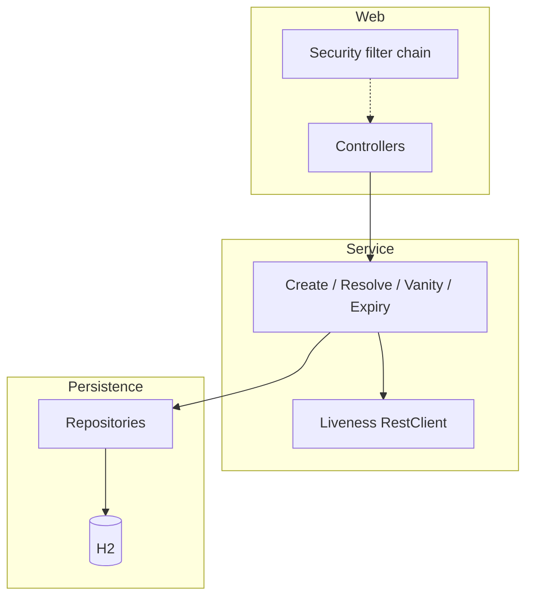
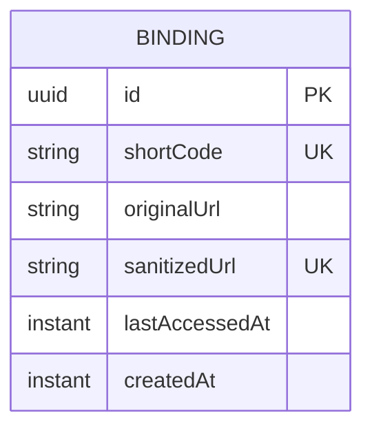

# Architecture Spine — MerchantSlipUrl Tiny URL Service

## Design Paradigm

**Layered microservice** — one Spring Boot deployable.

| Layer | Responsibility | Package (seed) |
| --- | --- | --- |
| Web | HTTP adapters only: REST create/vanity, resolve redirect, Security filter chain | `…web` |
| Service | Create pipeline, liveness check, vanity assign, expiry rules, sole store mutation (including last-access) | `…service` |
| Persistence | JPA entities + repositories against H2 | `…persistence` |

Dependency direction: Web → Service → Persistence. Web must not call Persistence. Outbound liveness HTTP is invoked only from Service.



## Invariants & Rules

### AD-1 — Layered single deployable [ADOPTED]

- **Binds:** all capabilities
- **Prevents:** Hexagonal or multi-service splits that place create rules and persistence under different owners
- **Rule:** One Spring Boot process; packages follow Web → Service → Persistence; controllers contain no binding or liveness business rules

### AD-2 — Service layer sole mutator [ADOPTED]

- **Binds:** CAP-1, CAP-2, CAP-3, CAP-5, CAP-7, CAP-8; create and resolve pipelines
- **Prevents:** Controllers writing the binding store; dual owners of `lastAccessedAt`; non-atomic concurrent creates corrupting mappings
- **Rule:** All persistence of bindings — including create, vanity shortCode change, and last-access on resolve — goes through the service layer inside a transaction (or equivalent atomic write). Create bind path: check-then-bind or return existing under that transaction

### AD-3 — H2 is the binding store [ADOPTED]

- **Binds:** CAP-1..CAP-8 persistence
- **Prevents:** Dual stores (e.g. in-memory map + DB) diverging for the same binding
- **Rule:** Spring Data JPA repositories backed by embedded H2 are the only binding store; H2 version comes from the Spring Boot BOM

### AD-4 — Liveness inside create [ADOPTED]

- **Binds:** CAP-4; create pipeline
- **Prevents:** Create without the gate; split retry semantics; liveness inside the binding write transaction blocking the store
- **Rule:** The HTTP liveness check of the **original** merchant-pasted long URL runs inside the service-layer create use case via RestClient, **before** the binding write transaction. Do not follow redirects; success means HTTP 2xx or 3xx on that URL. Read at most 64 KiB of the body; reaching that limit does not fail a 2xx or 3xx. Policy: 404-class fails immediately; timeout/5xx up to 3 attempts × 30s each; nothing is stored on failure. Storage still keeps the original string

### AD-5 — Security path rules [ADOPTED]

- **Binds:** CAP-6, CAP-8; resolve CAP-2
- **Prevents:** Securing resolve; leaving create/vanity open
- **Rule:** One Spring Security filter chain with path rules: Basic Auth required for create and vanity-assign endpoints; resolve endpoint `permitAll`

### AD-6 — Local single-process runtime [ADOPTED]

- **Binds:** operational envelope for this altitude
- **Prevents:** Assuming shared H2 or sticky multi-instance without an explicit later decision
- **Rule:** Run as one local process with embedded Tomcat; do not design for multi-instance shared state until Deferred items are lifted

### AD-7 — Configurable inactivity and resolve refusal [ADOPTED]

- **Binds:** CAP-2, CAP-7
- **Prevents:** Hard-coded expiry; resolving missing or expired tiny URLs to a destination
- **Rule:** Inactivity period is application configuration (initial testing value: 5 minutes). Successful resolve updates last-access via the service layer. Missing or inactivity-expired tiny URLs must not return or redirect to the destination

### AD-8 — Binding identity and mute short form [ADOPTED]

- **Binds:** CAP-1, CAP-3, CAP-5, CAP-8
- **Prevents:** Using mutable `shortCode` as the only identity; encoding destination into the short form; CAP-3 vs vanity-at-create clashes
- **Rule:** Each binding has a stable surrogate primary key. `sanitizedUrl` is unique and is the idempotency lookup key (same sanitized long URL → same binding). `shortCode` is unique and **mutable** (vanity assign updates it only; original URL unchanged). Default create without vanity generates a unique opaque `shortCode` that must not encode destination or order content. If a binding already exists for `sanitizedUrl`, return that binding’s current tiny URL and do not invent a second binding (vanity for an existing binding uses the assign path)

## Consistency Conventions

| Concern | Convention |
| --- | --- |
| Naming | Java packages under a single root (e.g. `com.merchantslipurl…`); layers `web` / `service` / `persistence` |
| Data & formats | Create/vanity: JSON with tiny URL + original long URL; resolve: HTTP redirect to stored original URL when active; error responses use consistent HTTP status + body from the web layer |
| State & cross-cutting | Mutations only in transactional service methods; sanitize before lookup; Basic Auth via Spring Security local user config; inactivity via config property; RestClient bean owned by service layer |

## Stack

| Name | Version |
| --- | --- |
| Java | 21 (overrides Initializr default 17) |
| Spring Boot | 4.1.1 |
| spring-boot-starter-webmvc | BOM-managed |
| spring-boot-starter-security | BOM-managed |
| spring-boot-starter-data-jpa | BOM-managed |
| spring-boot-starter-restclient | BOM-managed |
| H2 | BOM-managed |
| Test starters | `webmvc-test`, `security-test`, `data-jpa-test` (Boot 4 modular test starters) |
| Build | Gradle 8.14+ or 9.x |
| Servlet container | Embedded Tomcat (Boot default) |

## Structural Seed

```text
MerchantSlipUrl/
  src/main/java/…/
    MerchantSlipUrlApplication.java
    web/           # controllers + SecurityFilterChain config
    service/       # create, resolve, vanity, expiry, liveness
    persistence/   # entities + repositories
  src/main/resources/
    application.properties   # inactivity period, Basic Auth user, H2
  build.gradle.kts / build.gradle
```



## Capability → Architecture Map

| Capability / Area | Lives in | Governed by |
| --- | --- | --- |
| CAP-1 Create default tiny URL | `service` create + `persistence` | AD-1, AD-2, AD-3, AD-8 |
| CAP-2 Resolve | `web` redirect + `service` resolve | AD-1, AD-2, AD-5, AD-7 |
| CAP-3 Idempotent create | `service` create transaction | AD-2, AD-8 |
| CAP-4 Liveness gate | `service` create + RestClient | AD-4 |
| CAP-5 Create response (tiny + original); mute short form | `web` + `service` | AD-1, AD-8 |
| CAP-6 Basic Auth create | `web` Security | AD-5 |
| CAP-7 Inactivity expiry | `service` resolve + config | AD-2, AD-7 |
| CAP-8 Vanity create/assign | `service` + `persistence` | AD-2, AD-5, AD-8 |

## Deferred

| Item | Why it can wait |
| --- | --- |
| Exact default `shortCode` alphabet/length algorithm | Must be unique and opaque per AD-8; algorithm detail can be chosen in story 1 without cross-story drift if uniqueness holds |
| Exact sanitize normalization rules | Must produce stable unique `sanitizedUrl` keys; fine-grained normalize rules belong in implementation with tests |
| External DB (Postgres, etc.) | Embedded H2 covers local single-process |
| Multi-instance / shared store | AD-6 forbids assuming it |
| Container orchestration / cloud deploy | Local Tomcat is enough for story implementation |
| Observability beyond last-access | Spec non-goal for analytics |
| Credential store beyond local Security user | Local Basic Auth sufficient until shared secrets are needed |
